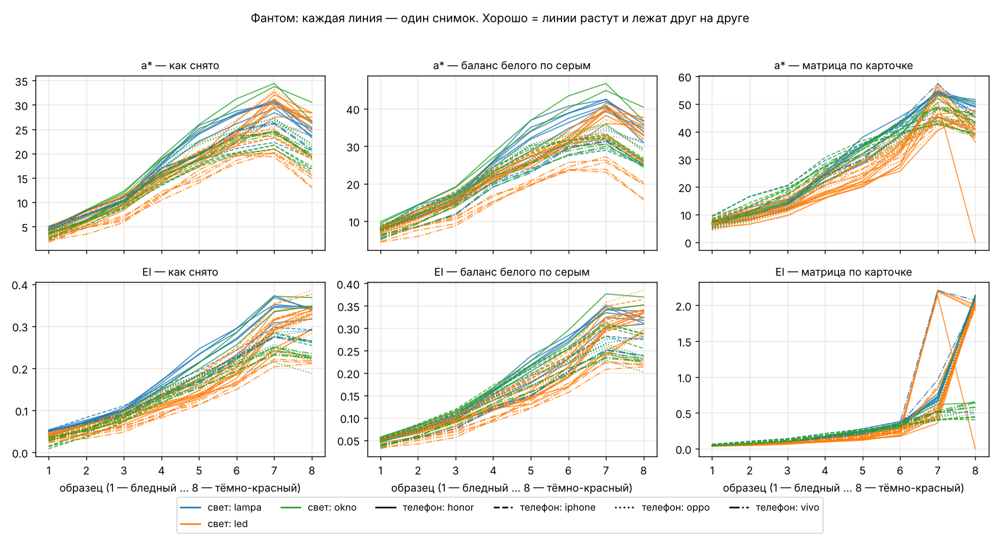
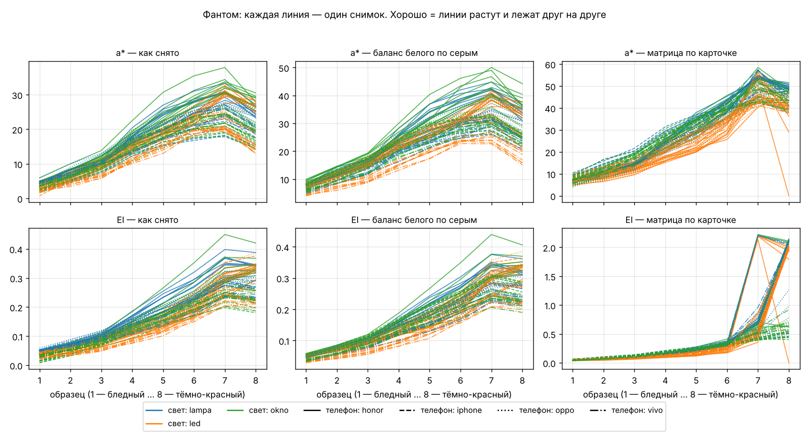

# Фантом-эксперимент HemaVision: результат 2026-11-22

**Итог: основной тест по критериям, записанным до съёмки, — НЕ ПРОЙДЕН.** Разведочный анализ даёт только гипотезы
для будущей работы.

Фантом проверяет воспроизводимость съёмки и цветопередачи, а не медицинскую точность HemaVision.

- Протокол и критерии (зафиксированы 2026-11-18, до съёмки): [../phantom_experiment.md](../phantom_experiment.md).
- Код: `anemia/phantom.py`, `scripts/phantom_analysis.py`, тесты `tests/test_phantom.py`. Основной анализ выполнен
  кодом коммита `5c60d6c` (ветка `claude/project-thread-z31yiz`); режим `--exploratory` добавлен позже, после
  просмотра данных, и основной анализ не меняет (тот же результат при запуске без флага — проверено, расхождение 0).
- Материалы: [2026-11-22/](2026-11-22/) — отчёты `report_primary.md` / `report_exploratory.md`, сводки
  `summary_primary.csv` / `summary_exploratory.csv`, все замеры `samples_primary.csv`, пропущенные снимки
  `skipped_primary.csv`, графики `phantom_plot_primary.png` / `phantom_plot_exploratory.png`, примеры обрезанного
  листа `examples_cropped_sheet.jpg`.
- Исходные снимки в репозиторий не входят: общая папка проекта `фантом/` (Honor, Oppo, Vivo) и `iphone/`
  (iPhone 15 Pro), по одному PDF на телефон × свет. Копия отчётов — `phantom/result_2026-11-22/` (там же расчёт на
  3 телефонах до прихода iPhone, `3phones_old/`, выводы те же).

## Что снимали

Один напечатанный лист A4 (`phantom-card-v1`: 4 маркера ArUco, 12 эталонных полей, шкала S1–S8 от бледно-розового к
тёмно-красному). 4 телефона — Honor X7d, Oppo Reno 5, Vivo V21e, iPhone 15 Pro — × 3 вида света (окно, тёплая
лампа, белый LED), по 8 снимков (у iPhone при белом свете 9): **97 снимков**. Снимки извлечены из PDF без
пересжатия (`pdfimages -j`).

Метрики для каждого образца: a* (CIELAB, D65) и Erythema Index, в трёх вариантах — `raw` (как снято), `wb` (баланс
белого по серым полям), `ccm` (аффинная матрица 3×4 по карточке). `sd_step` — разброс одного образца по снимкам в
долях шага шкалы (< 0,5 — соседние образцы различимы).

## 1. Основной анализ (критерии до съёмки) — НЕ ПРОЙДЕН

Критерии для `ccm`, a*: порядок S1→S8 верен на ≥ 90% снимков, `sd_step` ≤ 0,5, карточка применена к ≥ 80% снимков,
и карточка уменьшает разброс по сравнению с `raw`.

| вариант | метрика | снимков | порядок верен | sd_step | от света | от телефона | ΔE карточки |
|---|---|---|---|---|---|---|---|
| raw | a* | 48 | 0% | 0.73 | 0.42 | 0.68 | 17.1 |
| raw | EI | 48 | 50% | 0.66 | 0.45 | 0.49 | 17.1 |
| wb | a* | 48 | 0% | 0.91 | 0.46 | 0.85 | 10.6 |
| wb | EI | 48 | 48% | 0.67 | 0.28 | 0.59 | 10.6 |
| ccm | a* | 48 | 10% | 0.68 | 0.45 | 0.40 | 6.1 |
| ccm | EI | 48 | 81% | 0.69 | 0.57 | 0.41 | 6.1 |

Вердикт: **НЕ ПРОЙДЕН** (ccm, a*: карточка применена к 48 из 97 снимков; порядок верен на 10%; разброс 0,68 шага).
Не выполнены три критерия из четырёх: охват, порядок, разброс.



## 2. Причины (проверено по данным)

1. **49 из 97 снимков без полного обнаружения карточки**: найдено < 3 из 4 угловых маркеров, лист обрезан краем
   кадра (iPhone 14 из 25, Oppo 13, Vivo 13, Honor 9; `skipped_primary.csv`, `examples_cropped_sheet.jpg`).
   Это нарушение протокола съёмки (п. 4 протокола: «все 4 чёрных квадрата в кадре»).
2. **Проблема печати S8**: на 100% разобранных снимков всех 4 телефонов a* образца S8 ниже, чем у S7, — принтер
   напечатал самый тёмный красный бурым (вне гаммы принтера). Порядок S1…S7 при этом почти везде верен. Это
   свойство напечатанного фантома, а не камеры.
3. **Матрица по карточке экстраполирует тёмно-красные**: у S7/S8 зелёный канал после `ccm` уходит в 0
   (39 значений вне гаммы), EI скачет до ≈ 2. На карточке одно насыщенное красное поле.

## 3. Разведочный анализ — выполнен ПОСЛЕ просмотра данных

**Только гипотеза, не подтверждение.** Режим выбран после того, как мы увидели причины провала: лист ищется по
≥ 2 маркерам вместо 3 и образец S8 исключён (`--exploratory`). 89 из 97 снимков (Honor 24, iPhone 22, Oppo 22,
Vivo 21).

| вариант | метрика | порядок верен (S1–S7) | sd_step | от света | от телефона | ΔE карточки |
|---|---|---|---|---|---|---|
| raw | a* | 94% | 0.71 | 0.39 | 0.60 | 17.4 |
| raw | EI | 100% | 0.59 | 0.35 | 0.37 | 17.4 |
| wb | a* | 92% | 0.80 | 0.43 | 0.69 | 10.8 |
| ccm | a* | 100% | 0.53 | 0.34 | 0.36 | 5.9 |
| ccm | EI | 99% | 0.53 | 0.50 | 0.32 | 5.9 |

Гипотезы для будущей работы:
- после матрицы по карточке порядок S1–S7 сохраняется на 100% снимков всех 4 телефонов;
- карточка уменьшает разницу между телефонами по a* примерно на 40% (0,60 → 0,36 шага), общий разброс
  0,71 → 0,53 — всё равно выше заранее заданной границы 0,5;
- влияние света почти не уменьшается (a*: 0,39 → 0,34), по EI даже растёт (0,35 → 0,50);
- баланс белого по серым полям хуже, чем «как снято».

Справочный вердикт по тем же критериям — тоже НЕ ПРОЙДЕН (разброс 0,53 > 0,5).



## 4. Ограничения

- **PDF-экспорт, оригиналов камеры нет.** Снимки пришли как PDF, собранные на iPhone: у Android-телефонов
  уменьшены до 1280×960 и пережаты, у iPhone 4284×5712; цветовой профиль (Display P3) читается как sRGB.
- **Один принтер, один лист, одна бумага** — абсолютные a*/EI зависят от принтера; S8 вне его гаммы.
- Половина снимков без всего листа в кадре; 4 телефона и 3 вида света — малая выборка, вывод только «на этих
  условиях».
- Шаг шкалы a* ≈ 6–7 на образец; разница «норма / анемия» у конъюнктивы может быть меньше.
- Повторная съёмка командой не планируется (решение 2026-11-22).

## 5. Почему результат не подтверждает точность определения анемии

Фантом — бумага с напечатанными оттенками. В нём нет крови, гемоглобина, конъюнктивы, века, людей. Он проверяет
только цепочку «камера телефона → цвет → коррекция». Связь цвета с Hb, сегментация, модель риска и пороги в этом
эксперименте не участвуют. Точность HemaVision по-прежнему известна только по Eyes-defy (см. `results/metrics_history.csv`)
и будет проверяться в пилоте с анализом крови.

## 6. Почему цветовую коррекцию нельзя считать готовой для основной модели

- Основной тест не пройден; положительные цифры есть только в разведочном анализе.
- Даже разведочно коррекция не убирает влияние света — главную проблему (смена уровня риска при другом свете).
- Матрица неустойчива для цветов насыщеннее карточки (выход из гаммы, EI до ≈ 2).
- Модель риска обучена на Eyes-defy без карточки; коррекция изменила бы распределение признаков — нужна отдельная
  проверка и переобучение.
- Карточка A4 рядом с глазом в кадр не помещается; маленькой карты в кадре нет.

Поэтому коррекция (`ccm`, `wb`) в основной анализ **не внедряется**, модель, признаки, пороги и правила отказа не
меняются. В пилоте основной анализ — без индивидуальной коррекции; решение о карте в кадре остаётся открытым
(см. [../pilot/README.md](../pilot/README.md)).

## 7. Открытые вопросы

1. Нужна ли маленькая карта в кадре (вариант А пилота) и успеваем ли её сделать и проверить до заморозки модели.
2. Карточка v2: S8 в пределах гаммы принтера, больше розово-красных эталонных полей — только если будет новая съёмка.
3. Как уменьшить влияние света, если карточка его не убирает (стандартизация освещения при съёмке?).

## Как воспроизвести

```bash
pdfimages -j "<телефон> <свет>.pdf" photos/<телефон>/<okno|lampa|led>/img    # из каждого PDF
python scripts/phantom_analysis.py analyze --photos photos --out out_primary
python scripts/phantom_analysis.py analyze --photos photos --out out_explor --exploratory
```
